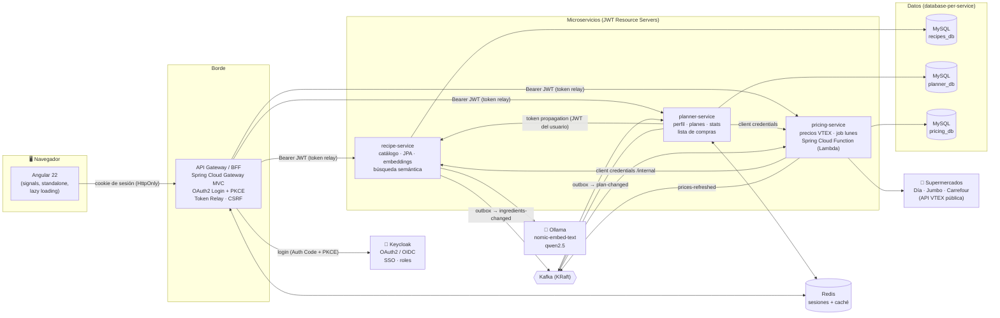

# 🥑 NutriPlan

> Planificador semanal de comidas para **bajar de peso**: recetas saludables, plan automático según tu objetivo calórico, estadísticas nutricionales, lista de compras por góndola y **precios estimados de supermercados argentinos**.

Proyecto de portafolio **Java 21 + Spring Boot 4 + Angular 22** con arquitectura de **microservicios**, pensado para practicar (y explicar en entrevistas) las herramientas que más piden en el mercado: Spring Security + OAuth2 + Keycloak, JPA/Hibernate, Kafka, Redis, búsqueda semántica con embeddings, serverless, testing con ArchUnit y más. **Cada clase está comentada explicando el *por qué***, y la carpeta [`docs/`](docs/) tiene una guía por tema.

---

## Arquitectura



| Componente | Responsabilidad | Tecnologías clave |
|---|---|---|
| **frontend** | SPA: plan semanal, recetas, stats, compras, perfil | Angular 22 (standalone, signals, control flow `@if/@for`), Reactive Forms, Chart.js, interceptores funcionales, guards, lazy loading |
| **gateway** | Único punto de entrada. BFF: login y sesión; el navegador nunca ve tokens | Spring Cloud Gateway Server MVC, OAuth2 Client (PKCE), Spring Session + Redis, Token Relay, CSRF SPA, CSP |
| **recipe-service** | Catálogo de 133 recetas, búsqueda clásica y semántica, importación | Spring Data JPA, Hibernate 7, Specifications, `@EntityGraph`, Flyway, MapStruct, embeddings (Ollama), LLM para estimar nutrición, Transactional Outbox |
| **planner-service** | Perfil (BMR/TDEE), plan semanal, generación automática, estadísticas, lista de compras | DDD (aggregate `WeeklyPlan`), Strategy pattern, RestClient + `@Retryable` (Spring 7), OAuth2 client credentials, Redis cache, Kafka consumer con DLT e idempotencia |
| **pricing-service** | Precios de supermercados, job **todos los lunes**, estimación de la compra | Spring Cloud Function (deployable como **AWS Lambda**), `@Scheduled`, Resilience4j Circuit Breaker, Adapter pattern por cadena |
| **common** | Starter interno compartido | Auto-configuration propia: validación JWT (firma/iss/aud), roles de Keycloak, `@PreAuthorize`, ProblemDetail (RFC 9457), audit log + correlation id |
| **infra** | Todo levanta con un comando | Docker Compose: MySQL 8.4, Keycloak 26, Kafka 4 (KRaft), Redis 8, Kafka UI |

---

## Funcionalidades

- 🗓️ **Plan semanal** por usuario: desayuno, almuerzo, merienda y cena (cada comida es opcional), para N personas.
- 🤖 **Generación automática** que se ajusta a tu objetivo de calorías, prioriza proteína y variedad, respeta ingredientes que no comés y entiende preferencias en lenguaje natural (*"comida casera con pollo"*).
- 🔎 **Búsqueda semántica** de recetas con embeddings (*"algo liviano para la cena"*), además de filtros clásicos.
- ⚖️ **Perfil y objetivos**: BMR (Mifflin-St Jeor), TDEE, déficit calórico, proteínas 1,6 g/kg, semanas estimadas a tu peso objetivo.
- 📊 **Estadísticas** por semana: kcal y macros por día vs. objetivo, adherencia, cambio de peso proyectado, historial de semanas y de peso.
- 🛒 **Lista de compras** agregada (convierte tazas/cucharadas a ml/g y suma entre recetas), ordenada por góndola, con **costo estimado en Día, Jumbo y Carrefour**, copiar para WhatsApp e imprimir.
- ✅ Seguimiento: marcar comidas como "comí", repetir la semana anterior, escalar porciones.

---

## Cómo correrlo

Requisitos: **Java 21, Maven, Docker, Node 24.15+** y (opcional) **[Ollama](https://ollama.com)** con `ollama pull nomic-embed-text qwen2.5:7b`.

```bash
# 1) Infraestructura (MySQL, Keycloak, Kafka, Redis, Kafka UI)
docker compose -f infra/docker-compose.yml up -d

# 2) Backend (en 4 terminales, o ver scripts/dev-up.sh)
cd backend && mvn -q install -DskipTests
cd recipe-service  && mvn spring-boot:run   # :8081
cd planner-service && mvn spring-boot:run   # :8082
cd pricing-service && mvn spring-boot:run   # :8083
cd gateway         && mvn spring-boot:run   # :8080

# 3) Frontend
cd frontend && npm install && npx ng serve  # http://localhost:4200
```

Usuarios de prueba (solo desarrollo): `demo / demo123` y `admin / admin123` (rol ADMIN).

| URL | Qué es |
|---|---|
| http://localhost:4200 | App (Angular) |
| http://localhost:8081/swagger-ui.html · :8082 · :8083 | Swagger / OpenAPI de cada microservicio (botón *Authorize* = login real con PKCE) |
| http://localhost:8180 | Keycloak (admin / admin_dev_only) |
| http://localhost:8090 | Kafka UI (ver tópicos y mensajes) |

> **Datos de recetas**: el recetario original es material de un curso pago y **no está en el repositorio** (`data/private/` está en `.gitignore`). Sin él, el servicio importa una muestra pública de [`data/sample/`](data/sample/). Ver [docs/02-infraestructura-local.md](docs/02-infraestructura-local.md).

---

## Guías (docs/)

| # | Tema |
|---|---|
| 01 | [Arquitectura, microservicios y clean architecture](docs/01-arquitectura.md) |
| 02 | [Infraestructura local paso a paso](docs/02-infraestructura-local.md) |
| 03 | [Seguridad: JWT, OAuth2, OIDC, PKCE, Keycloak, BFF, client credentials, mTLS](docs/03-seguridad.md) |
| 04 | [JPA / Hibernate: mapeos, N+1, locking, Flyway](docs/04-jpa-hibernate.md) |
| 05 | [Patrones de diseño usados (con ubicación en el código)](docs/05-patrones-diseno.md) |
| 06 | [Kafka: outbox, DLT, idempotencia](docs/06-kafka-mensajeria.md) |
| 07 | [Redis: sesiones del BFF y caché](docs/07-redis-cache-sesiones.md) |
| 08 | [IA: embeddings, búsqueda semántica y estimación con LLM](docs/08-ia-embeddings.md) |
| 09 | [Serverless: Spring Cloud Function y AWS Lambda](docs/09-serverless.md) |
| 10 | [Testing: unitarios, slices, ArchUnit, Testcontainers](docs/10-testing.md) |
| 11 | [Precios de supermercados (VTEX y SEPA)](docs/11-precios-supermercados.md) |
| 12 | [**Preguntas de entrevista** respondidas con este proyecto](docs/12-preguntas-entrevista.md) |

---

## Estado y próximos pasos

Hecho y probado de punta a punta en local: login BFF con Keycloak, 3 microservicios + gateway, importación y búsqueda semántica, generación de planes, estadísticas, lista de compras con precios reales, Kafka (outbox → consumo → invalidación de caché) y 65 tests (unitarios, slice web y ArchUnit).

Ideas para seguir: tests de integración con Testcontainers en CI, mTLS habilitado por defecto en Docker, despliegue en AWS (ECS + RDS + MSK o Lambda), notificaciones (recordatorio del lunes con la lista de compras), modo "despensa" (descontar lo que ya tenés), recetas propias del usuario.

> ⚠️ Las calorías y objetivos son orientativos; no reemplazan el consejo de un profesional de la salud.
