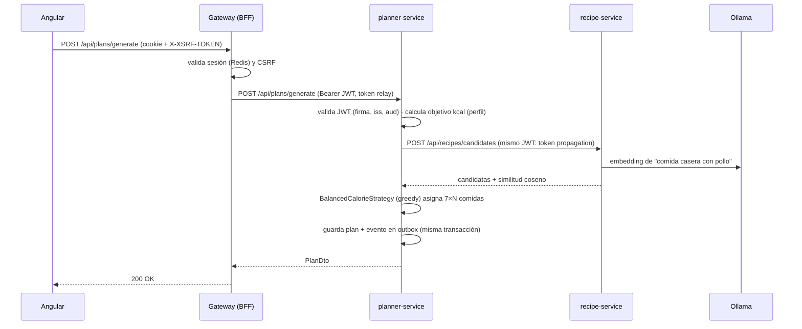

# 01 · Arquitectura

## ¿Por qué microservicios?

Para una app de este tamaño un **monolito modular** sería suficiente (y es lo que recomendaría en una startup real). Elegimos microservicios **a propósito**, para practicar los problemas que aparecen cuando el sistema está distribuido y que siempre preguntan en las entrevistas:

- autenticación entre servicios (token propagation vs. client credentials),
- consistencia de datos sin transacciones distribuidas (Transactional Outbox),
- mensajería asíncrona (Kafka) y consumidores idempotentes,
- degradación elegante cuando un servicio falla (circuit breaker, retry, fallback),
- base de datos por servicio.

Los servicios se cortaron por **bounded context** (DDD), no por capas técnicas:

| Servicio | Contexto | Dueño de |
|---|---|---|
| recipe-service | Catálogo | recetas, ingredientes, categorías, embeddings |
| planner-service | Planificación | perfil del usuario, planes semanales, pesos |
| pricing-service | Precios | productos de supermercados, historial de precios |
| gateway | Borde / BFF | sesión del usuario, enrutamiento |

## Comunicación

| Desde → Hacia | Tipo | Autenticación | Por qué |
|---|---|---|---|
| Navegador → gateway | HTTP | cookie de sesión HttpOnly | patrón BFF: el navegador no maneja tokens |
| gateway → servicios | HTTP | JWT del usuario (token relay) | el servicio sabe QUIÉN es el usuario |
| planner → recipe | HTTP síncrono | JWT del usuario (token propagation) | operaciones en nombre del usuario |
| planner → pricing | HTTP síncrono | client credentials (rol SERVICE) | pricing no necesita saber del usuario |
| pricing → recipe `/internal` | HTTP síncrono | client credentials | corre en un job, no hay usuario |
| recipe → pricing | **Kafka** (outbox) | — | desacople: pricing se entera de ingredientes nuevos |
| pricing → planner | **Kafka** | — | aviso de precios nuevos → invalidar caché |

Regla práctica: **síncrono** cuando necesito la respuesta para contestarle al usuario; **asíncrono** cuando es una notificación de que algo pasó.

## Clean / Hexagonal architecture dentro de cada servicio

```
com.nutriplan.<servicio>
├── domain          ← reglas de negocio puras (entidades, value objects, servicios de dominio, puertos)
│   ├── model
│   ├── service     ← EnergyCalculator, IngredientLineParser, ShoppingListBuilder... (sin Spring)
│   ├── port        ← interfaces hacia afuera: RecipeCatalogPort, EmbeddingGenerator, PricingPort
│   └── repository  ← interfaces Spring Data (compromiso pragmático, ver abajo)
├── application     ← casos de uso (orquestan dominio + puertos), DTOs, transacciones
├── infrastructure  ← adapters: clientes HTTP, Kafka, Ollama, VTEX, config
└── web             ← controllers REST (delgados)
```

**Regla de dependencias**: `web → application → domain ← infrastructure`. El dominio no conoce HTTP, Kafka ni Ollama: usa *puertos* (interfaces) que la infraestructura implementa (inversión de dependencias, la "D" de SOLID). Ejemplo: `planner` define `RecipeCatalogPort` y `RecipeServiceClient` lo implementa con `RestClient`. En los tests se puede reemplazar por un mock sin levantar nada.

Estas reglas **se verifican con tests** (`ArchitectureTest` con ArchUnit): si alguien hace que un controller use un repositorio, el build falla.

### Compromiso pragmático

En hexagonal "puro", las entidades de dominio no tendrían anotaciones JPA y habría un mapeo dominio ↔ entidad de persistencia. Acá las entidades de dominio **son** entidades JPA y los repositorios Spring Data viven en `domain.repository`. Es el compromiso más común en proyectos Spring reales: menos código duplicado a cambio de acoplar el dominio a Jakarta Persistence. Saber explicar este trade-off suma en una entrevista.

## Database per service

Un solo contenedor MySQL pero **tres esquemas y tres usuarios** (`infra/mysql/init.sql`), cada uno con permisos solo sobre su base (menor privilegio). Ningún servicio hace JOIN contra tablas de otro. Consecuencia: el planner guarda un **snapshot** (título y macros) de cada receta planificada (`NutritionSnapshot`), así las estadísticas funcionan aunque recipe-service esté caído.

## Diagrama de secuencia: generar un plan


